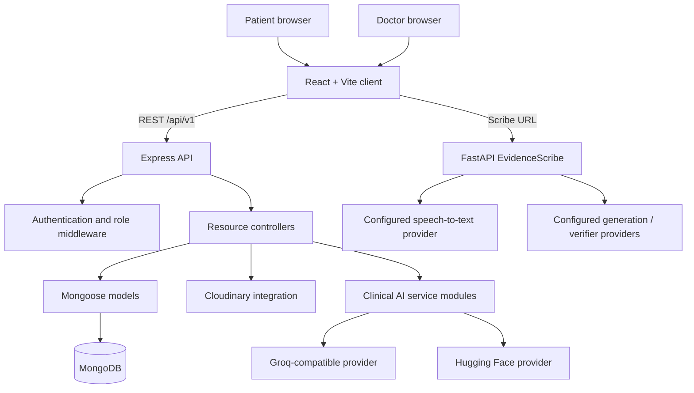

# MediBridge Architecture and Repository Map

## 1. System overview

MediBridge is a prototype healthcare workflow platform composed of three runnable application services:

1. **React/Vite client** — patient and doctor interfaces.
2. **Node.js/Express API** — authentication, healthcare resources, workflow controllers, persistence, and integrations.
3. **Python/FastAPI EvidenceScribe** — a separate clinical-documentation service.

The repository also includes external AI integrations, a Cloudinary integration, deployment manifests, seed data, and automated checks. This description is based on the current `main` branch source layout; implementation files are authoritative.

This is an academic/demo prototype. The repository does not establish formal ABDM certification or legal DPDP compliance.

## 2. Technology stack

| Area | Technology | Source |
|---|---|---|
| Frontend | React 19, Vite, React Router, Zustand, Axios, Tailwind CSS | `client/package.json` |
| Backend | Node.js, Express 5, Mongoose | `server/package.json` |
| Persistence | MongoDB / Mongoose; optional in-memory MongoDB for local/demo use | `server/src/config/db.js` |
| Scribe | Python, FastAPI, Pydantic | `services/scribe/app.py`, `requirements.txt` |
| AI integrations | Groq-compatible summarization / ASR and Hugging Face diagnostic-support integration | `server/src/services/`, `services/scribe/` |
| File storage | Cloudinary SDK integration | `server/src/config/cloudinary.js` |
| Hosting configuration | Vercel and Render | `vercel.json`, `render.yaml` |

## 3. High-level component diagram

## 4. Backend modules

Express setup and route mounting are in `server/src/app.js`. The health endpoint is `GET /api/v1/health`.

Current mounted route prefixes:

| Prefix | Responsibility |
|---|---|
| `/api/v1/auth` | Authentication |
| `/api/v1/profile` | Patient profile |
| `/api/v1/hospitals` | Hospital discovery and details |
| `/api/v1/records` | Medical records |
| `/api/v1/document-access` | Document access permissions |
| `/api/v1/prescriptions` | Prescriptions |
| `/api/v1/doctors` | Doctor and patient clinical workflows |
| `/api/v1/access` | Consent/access sessions and logs |
| `/api/v1/financial` | Loan workflow |
| `/api/v1/fundraisers` | Fundraising and donations |
| `/api/v1/emergency` | Emergency information |
| `/api/v1/mock/hospital` | Mock hospital integration |
| `/api/v1/appointments` | Appointment workflow |

Route files under `server/src/routes/` define exact methods and endpoints. Controllers handle requests; Mongoose schemas under `server/src/models/` define persisted entities. Authentication, role checks, access enforcement, validation, upload handling, and error handling live under `server/src/middleware/` and `server/src/validators/`.

## 5. Data model inventory

Model files currently include:

- `User`, `Doctor`, `Hospital`
- `MedicalRecord`, `Prescription`
- `AccessSession`, `AccessLog`, `ConsentGrant`, `DocumentAccessPermission`
- `EmergencyProfile`
- `Appointment`
- `LoanApplication`
- `FundraiserCampaign`, `Donation`

Refer to each schema for actual fields, indexes, validation, and relationships. This inventory is not a substitute for the schema definitions.

## 6. Frontend organization

- `client/src/pages/auth/`: login and registration.
- `client/src/pages/dashboard/`: patient and doctor dashboards and appointments.
- `client/src/pages/doctor/`: patient search, record review, record creation, prescriptions, and clinical scribe UI.
- `client/src/pages/records/`: record listing, detail, upload, and access management.
- `client/src/pages/hospitals/`: hospital search, detail, and appointment booking.
- `client/src/pages/access/`: access log.
- `client/src/pages/emergency/` and `client/src/pages/profile/`: emergency and profile/health ID workflows.
- `client/src/pages/financial/` and `client/src/pages/fundraiser/`: financial support workflows.
- `client/src/services/`: API calls grouped by resource.
- `client/src/routes/`: protected and role-aware route wrappers.

The shared Axios instance is `client/src/services/api.js`. It reads `VITE_API_URL`, adds `/api/v1` when needed, and sends credentials.

## 7. Consent and access control

The repository contains dedicated access and document-access route/controller/model modules, plus authentication and access middleware. Trace the implementation through the route, controller, middleware, model, and tests in `server/tests/`.

Do not describe the prototype as formally ABDM-certified or legally compliant solely because it implements consent/access features.

## 8. Clinical AI and EvidenceScribe

Backend AI modules:
- `server/src/services/aiSummarizerService.js`: clinical history summarization integration.
- `server/src/services/hfDiagnosticService.js`: diagnostic-support integration.
- `server/src/services/loanPredictionService.js` and `server/src/utils/loanEligibility.js`: financial eligibility workflow logic.

Model availability, output quality, and latency depend on configuration and runtime. Avoid fixed performance claims without reproducible live evaluation.

EvidenceScribe's root entry point is `services/scribe/app.py`, launched by the repository start scripts. It is a separate FastAPI service focused on evidence-linked note generation and review. Configuration and dependencies are in `services/scribe/.env.example` and `services/scribe/requirements.txt`.

The `services/scribe/backend/` subtree contains an additional EvidenceScribe implementation and its own documentation/data. The root launcher does not start its nested `backend/app.py`.

## 9. Runtime and deployment

| Service | Local port | Start command |
|---|---:|---|
| Client | 5173 | `cd client && npm run dev` |
| Express API | 5000 | `cd server && npm start` |
| EvidenceScribe | 8000 | `cd services/scribe && python app.py serve` |

The Windows, PowerShell, and shell launchers start these services separately. Install dependencies and configure environment files first.

Root `vercel.json` builds the client and serves `client/dist`. Root `render.yaml` defines the Node API and Python scribe services. Configure `VITE_API_URL`, `VITE_SCRIBE_URL`, and backend `CLIENT_URL` for deployed origins. Use persistent MongoDB for data that must survive restarts; in-memory storage is temporary.

See [Deployment Guide](DEPLOYMENT_GUIDE.md).

## 10. Verification

- Backend: `cd server && npm test`
- Frontend: `cd client && npm run build && npm run lint`
- Scribe: `cd services/scribe && python app.py selftest`
- Full local integration check: `python scripts/verify_platform.py` (requires services running)

A passing check confirms only the paths it exercises. It is not a security assessment, clinical validation, or regulatory certification.
